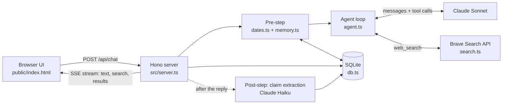
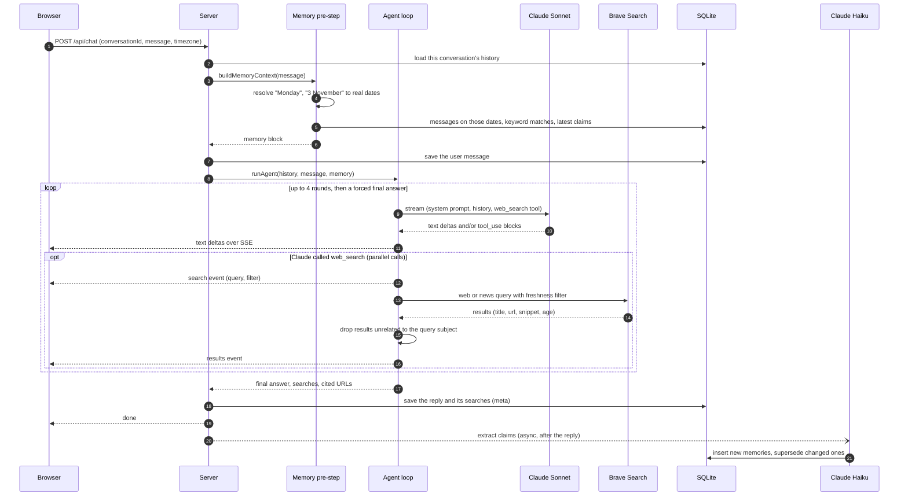
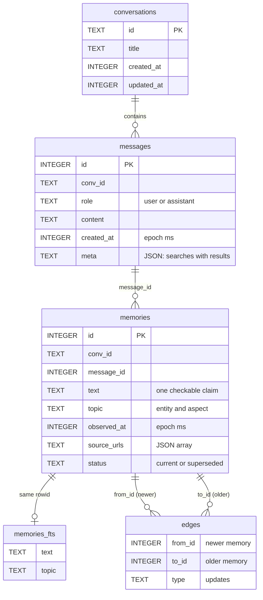
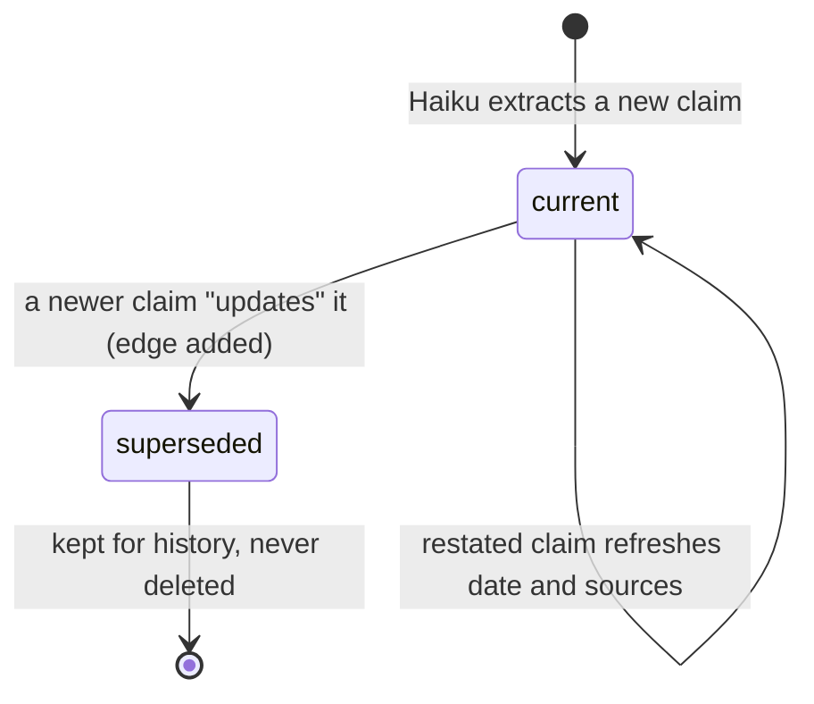
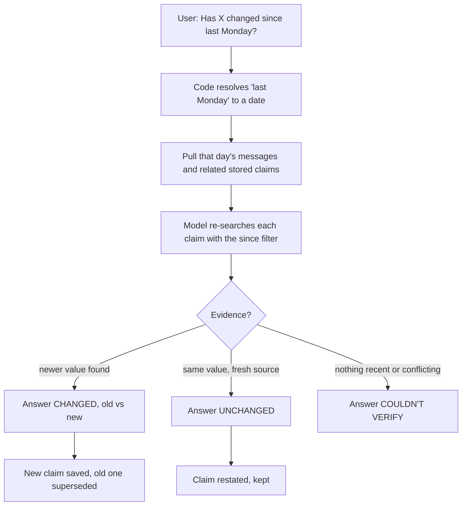

# DESIGN

## How it works
A Hono server streams (SSE) a hand-written tool-use loop over the Anthropic API. The model has one tool, `web_search`, backed by Brave. Everything else is plain code around it.

1. **Pre-step (code, before the model).** `dates.ts` resolves phrases like "Monday", "last Tuesday", "3 November", "2 weeks ago" to absolute dates in the user's timezone. `memory.ts` then pulls what was said on those days and any related stored claims, and puts them in the system prompt as `<memory>`. The model also gets the current date/time/timezone.
2. **Loop.** Sonnet streams its answer, calls `web_search` (several in parallel per step, max 4 rounds, then forced to answer). `since` and `recency` map to Brave's `freshness` filter, so "what changed since Monday" searches only newer pages.
3. **Post-step (async).** After the answer streams, Haiku extracts discrete claims into SQLite. A claim that contradicts an existing one gets an `updates` edge and the old one is marked superseded.

## Why this shape
- **The test prompts are about time and recall, not search.** So memory and date maths are the core, and they are deterministic code, not model guesses.
- **Memory is not a second tool.** The brief says one tool. A pre-step also removes a model round trip and the risk of it forgetting to look.
- **Supermemory-style memory without the infrastructure.** Claims have timestamps, sources, status and graph edges. That is a graph in an `edges` table in SQLite plus FTS5 for keywords. "Is your answer still correct?" becomes: load old claims, re-search them, compare, and record the update.
- **Speed.** Tokens stream from the first byte, searches run in parallel, the 10-minute search cache avoids repeats, and extraction never blocks the response. The UI shows searches live.
- **Honesty.** The prompt demands CHANGED / UNCHANGED / COULDN'T VERIFY per item, dated sources, and "no record" when memory is empty.

## Considered and rejected
- **Agent frameworks** (LangChain etc.): opaque, slower, harder to defend line by line.
- **Graph database (Neo4j):** a server and a driver for a tiny, shallow graph; breaks "npm install, npm run dev".
- **Vector memory:** fuzzy where the questions need exact dates and entities.
- **Memory as a model-callable tool:** extra latency, can be skipped by the model.
- **Anthropic's built-in web search:** less control over date filters than Brave's `freshness`.
- **Planner/critic multi-agent setup:** latency for little gain at this scope.

## Known limits
- Weekday phrases resolve to the most recent *past* occurrence; ambiguity is flagged to the model, not asked about.
- Memory recall is keyword (FTS5) + date based; single-user, no auth.
- Extraction quality depends on Haiku; a bad claim is possible, and old ones are never deleted, only superseded.

## With another week
Embeddings for fuzzy recall alongside FTS; a proper "re-verify" mode that re-searches each stored claim automatically and reports a diff; fetching full pages for pricing (snippets can miss tables); evals with a fixed question set and a judge model; per-user memory and auth; prompt caching on the system prompt.

## Architecture diagrams
GitHub renders these Mermaid diagrams.

### System overview

### One chat turn

### Database

#### Memory lifecycle

### "Is your answer still correct?"

